<p align="center">
  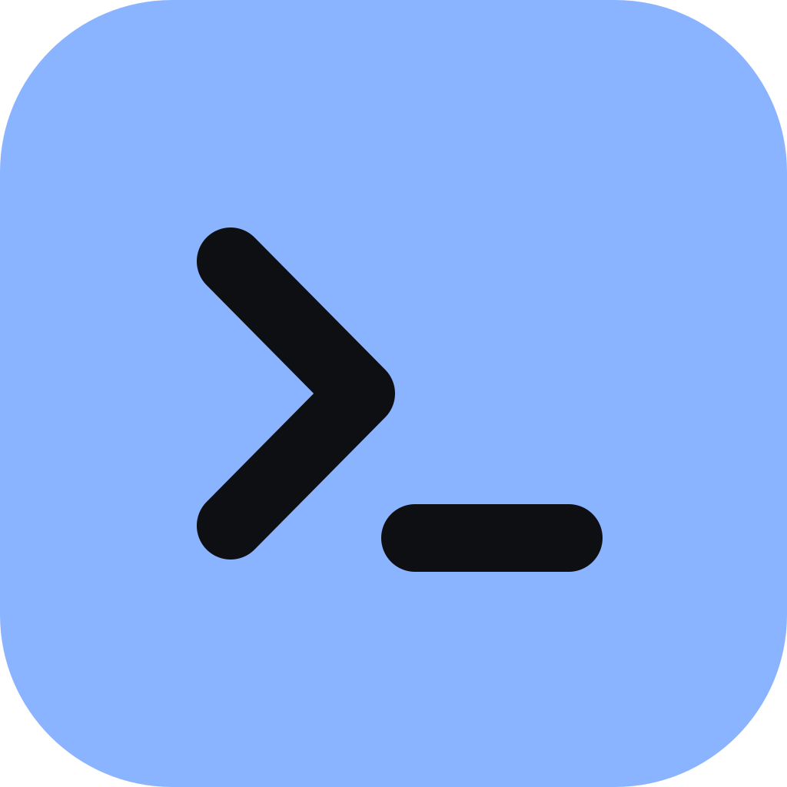
</p>

<h1 align="center">Rookery</h1>

<p align="center">
  <b>A calm, fast server manager for people with many servers.</b><br />
  Terminal, files, Docker, logs and a dashboard: one tab per server, everything stored on your own computer, encrypted.
</p>

<p align="center">
  <a href="https://github.com/aagzamov-dev/Rookery/releases/latest"></a>
  <a href="https://github.com/aagzamov-dev/Rookery/releases/download/v0.8.0/Rookery_0.8.0_x64-setup.exe"></a>
  <a href="https://github.com/aagzamov-dev/Rookery/releases/download/v0.8.0/Rookery_0.8.0_universal.dmg"></a>
  
</p>

<p align="center">
  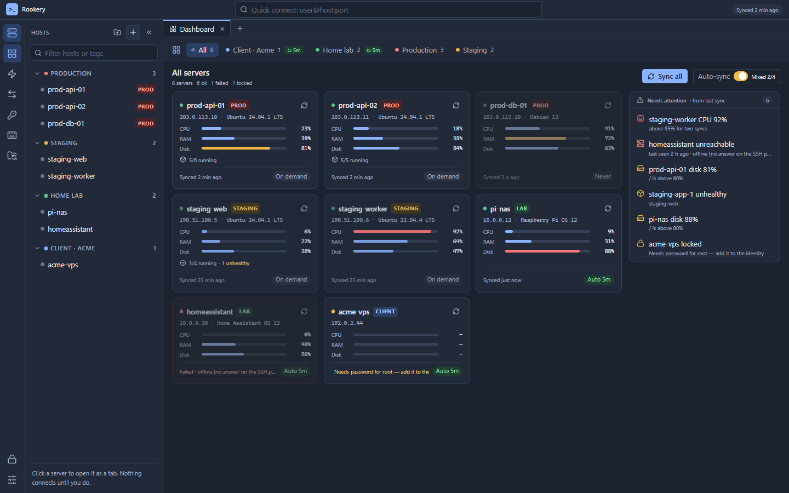
</p>

---

## What is Rookery?

Rookery is a desktop app for managing SSH servers: a lighter, cleaner alternative to MobaXterm or Termius.

You add your servers once and group them (Production, Staging, Home lab, a client…). A click opens a server as a **tab**, and that tab holds everything about it: terminals, files, Docker containers with logs, its databases, systemd services, processes and log files.

Everything stays on **your** computer: servers, logins, passwords and keys, snippets and shortcuts. Passwords and keys are encrypted in a vault you unlock with a 4-digit PIN. There is no account and no cloud service. When you want your laptop to match your PC, Rookery syncs through a folder **you** choose (Google Drive, OneDrive, Dropbox), still encrypted.

## Why you might like it

| | |
|---|---|
| 🔒 **Local and encrypted** | Vault: Argon2id + XChaCha20-Poly1305. The PIN unlocks it through the OS keychain. Secrets never reach the UI layer. |
| 💤 **Nothing connects until you ask** | Opening the app or the dashboard makes no connection. A server connects when you open its tab, and views only collect data while they're on screen. Your servers aren't polled in the background. |
| 🗂 **One tab per server** | Terminal, Files, Docker, Database, Services, Processes, Logs, all in one place, and kept as you left them when you switch tabs. |
| 🛢 **SQL that's safe on production** | PostgreSQL, MySQL, MariaDB: browse tables, run SQL, read results. PROD is read-only on the server until you allow changes, and nothing is saved until you Commit. |
| 🔁 **PC ↔ laptop sync without an account** | Each device writes its own encrypted file into your cloud folder. Newest edit wins, and deletions sync too. |
| ⚡ **Small and fast** | Rust core plus a native webview. About a 4 MB installer, no Electron. |
| ⌨️ **Keyboard first** | ~50 functions you can bind (MobaXterm / PuTTY, Windows Terminal and iTerm2 presets), a command palette, and snippets with aliases (`paserve` + Tab). |
| 📥 **Easy to move to** | Import from MobaXterm, PuTTY or `~/.ssh/config` in a minute. |
| 🔄 **Updates itself** | Signed updates from GitHub Releases: one click, and your data is kept. |

## A quick tour

### Terminal
An iTerm-style terminal (xterm.js + WebGL): themes (10 built in, plus iTerm `.itermcolors` import), find, broadcast typing to several terminals, copy/paste the way you like (MobaXterm or Windows Terminal style). Also:
- **Snippet bar:** one-click commands for this server, with `${variables}` and multi-step workflows. Production asks before running anything.
- **Triggers:** lines with ERROR / WARN, or your own patterns, get a coloured band and a mark in the scrollbar.
- **Sudo helper:** fills the sudo password from the vault; the webview never sees it.
- **Notification** when a long command finishes while you're elsewhere.
- **Session logs** to plain-text files, if you want them.
- **Local shells** too: PowerShell, cmd, WSL, Git Bash, zsh.

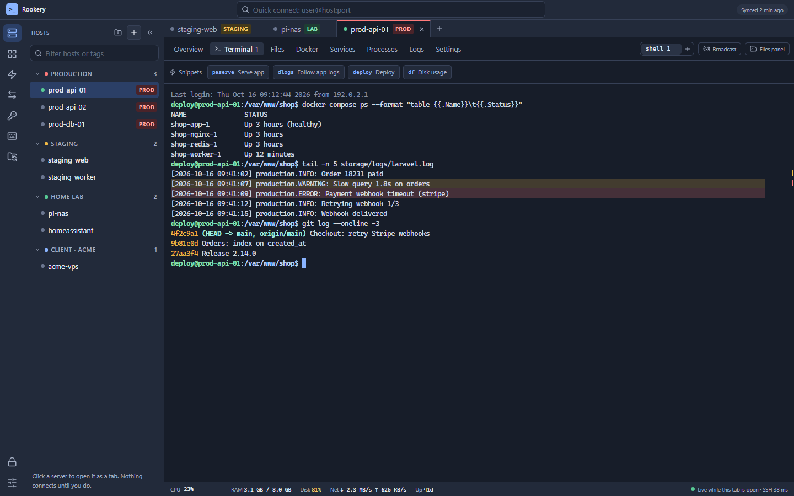

### Docker, without typing `docker`
- **Containers** grouped by compose project, with live CPU / memory.
- **Actions:** start / stop / restart, shell into a container.
- **Live logs** with error / warning filters and search.
- **No polling:** the list updates from `docker events`.

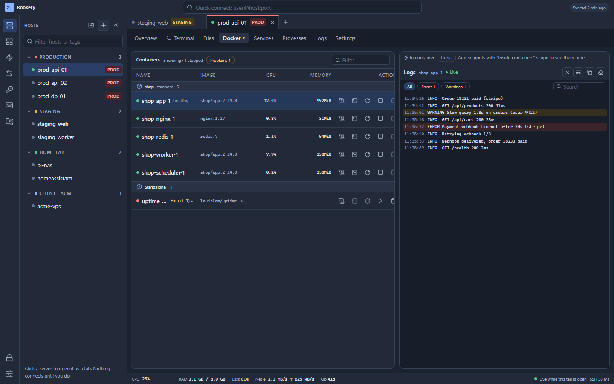

### Databases
PostgreSQL, MySQL and MariaDB, for a quick look-and-fix next to the terminal (not a full database IDE).
- **Where:** the **Database** view in a server tab (through its SSH session), or saved connections in the sidebar, each in its own tab: on this PC, direct with SSL, or through a server. Quick connect takes URLs like `postgres://user@host/db`.
- **Tables like HeidiSQL:** click a table and it opens as a tab next to **Query**.
  - **Data:** paged rows; click a header to sort; quick search; filters (=, contains, <, >, is NULL…) or your own WHERE.
  - **Right-click a cell** to filter by its value, or jump through a foreign key to the related row.
  - **Columns** can be reordered, resized and hidden, remembered per table. There's also a row detail panel, an exact Count and CSV.
  - **Structure:** columns, indexes, foreign keys both ways and the CREATE code.
- **Run it:** CodeMirror editor with completion of your tables and columns. Ctrl+Enter runs the statement at the cursor, and Cancel really stops it on the server. The results grid stays fast with many rows; copy or export CSV.
- **Shortcuts:** **Open in SQL** on a Docker database container, import a connection from a Laravel `.env`, and **Find databases on this PC** (XAMPP, Laragon, PostgreSQL, Docker). Query history per connection, and SQL snippets.
- **Safe on PROD:** read-only enforced by the database server. **Allow changes** turns writes on for 15 minutes; every change waits in a transaction until you **Commit**. DELETE without WHERE, DROP and friends ask first, and on PROD you type the database name.

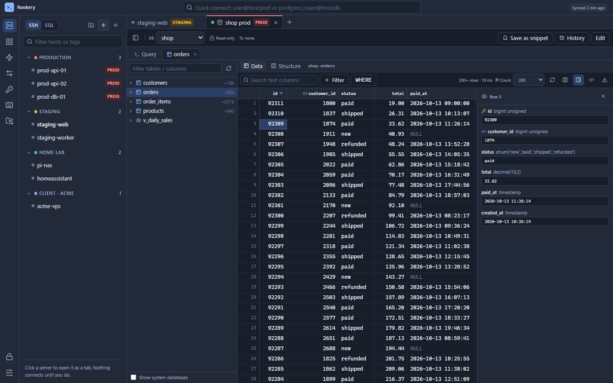

| Structure | SQL editor |
|---|---|
| 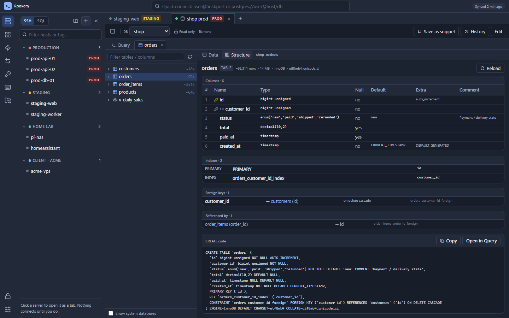 | 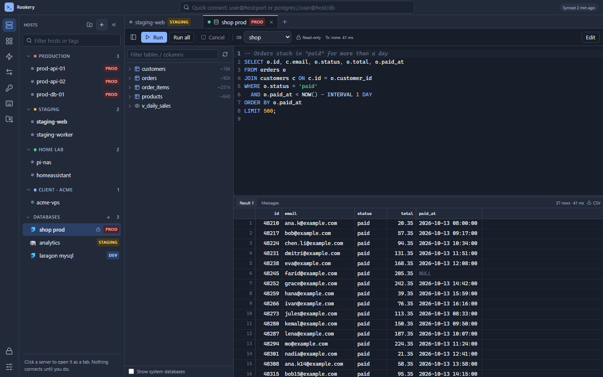 |

### Editor
Edit config files on the server (`.env`, `docker-compose.yml`, nginx…) without losing anyone's changes.
- **Comfortable:** folders and tabs, pinned files, highlighting for the usual config and code formats, find / replace, multi-cursor, **Format** (Prettier, and a careful `.env` tidy-up), problems while typing (JSON, YAML, `.env` duplicates and quoting), **Hide values** for secrets.
- **Never overwrites blindly:** saving checks the file is still the version you opened. If someone changed it, you get a three-way merge instead of a write. Coming back to the window checks for changes too.
- **Careful writes:** your own files are replaced in one step, so a dropped connection never leaves half a file. Other people's files keep their owner and permissions. **Save with sudo** when needed. What was written is read back and checked, and line endings and BOM stay as they were.
- **History:** the server's version before every save is kept on this PC. On PROD, every save shows the changes first.

| Editor | Someone changed it meanwhile |
|---|---|
| 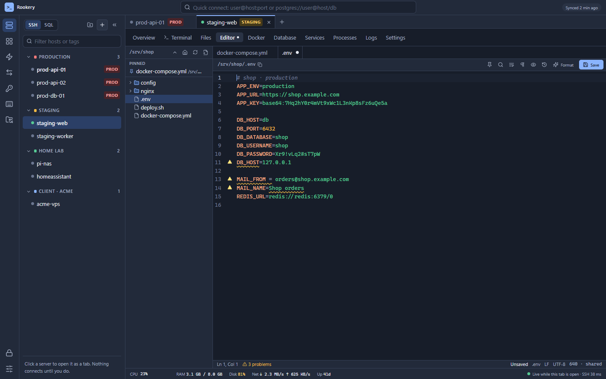 | 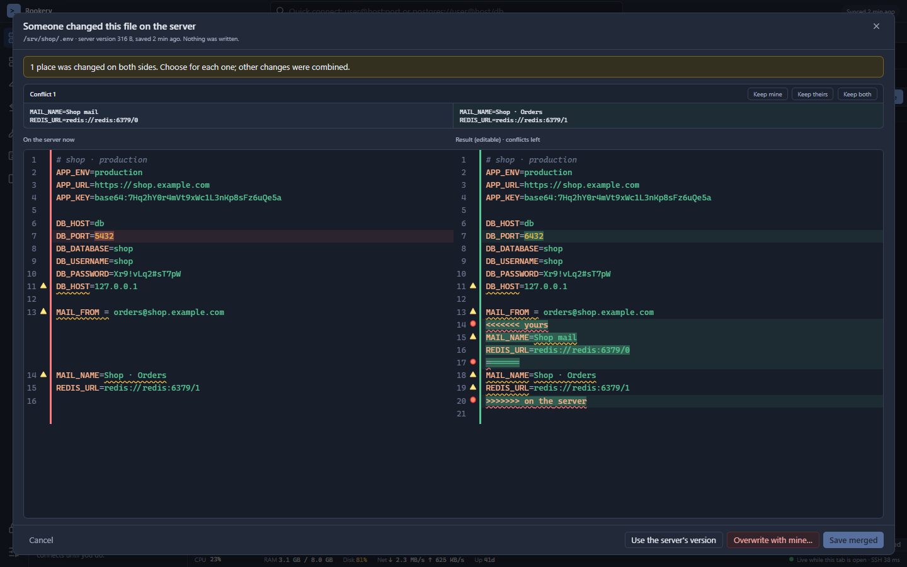 |

### Dashboard
- **Every server at a glance:** CPU, RAM, disk, containers, "synced 2 min ago".
- **Your choice of when:** it shows the last saved results, so opening it costs nothing. Press **Sync** for the selected group, or turn **Auto-sync** on per group with an interval.
- **Needs attention:** high CPU twice in a row, full disks, unhealthy containers, offline servers. Click one to jump to the right view.

### Backup & sync
- **Sync folder:** pick a folder that Google Drive / OneDrive / Dropbox syncs, set the same sync password on each device, done.
- **Backup file:** save one encrypted file, send it anywhere (Telegram, USB…), and import it with **Merge** or **Replace**.

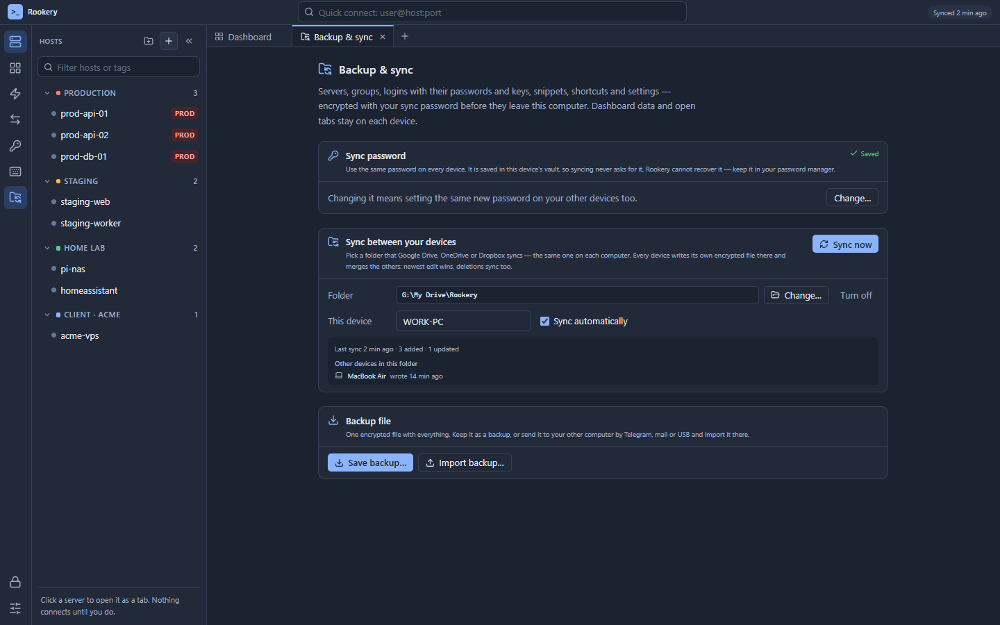

### And more

| Snippets | Shortcuts | Hosts |
|---|---|---|
| 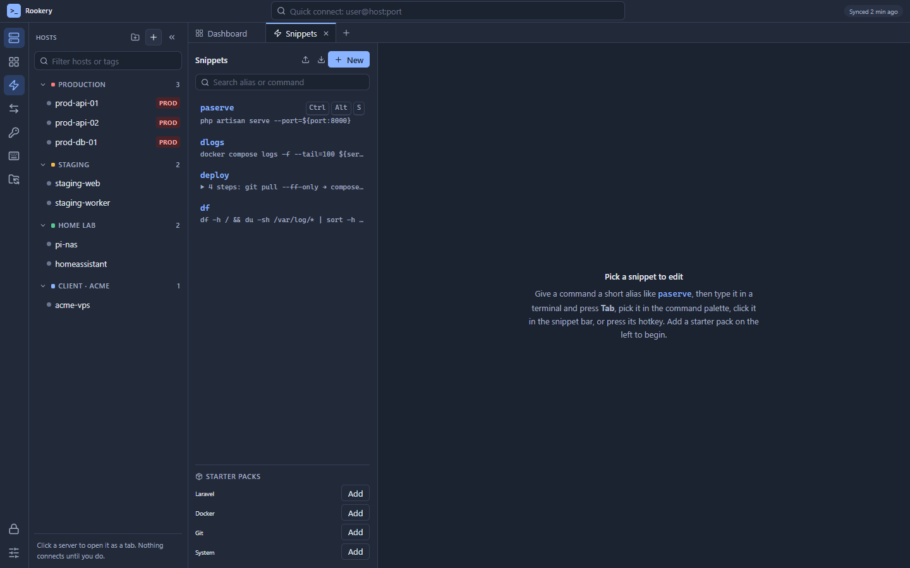 | 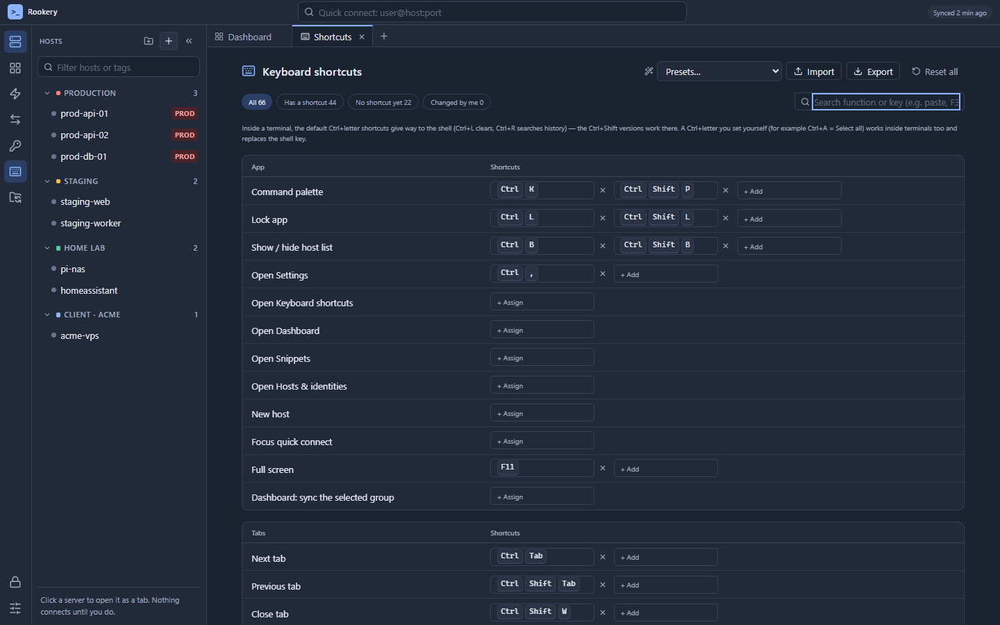 | 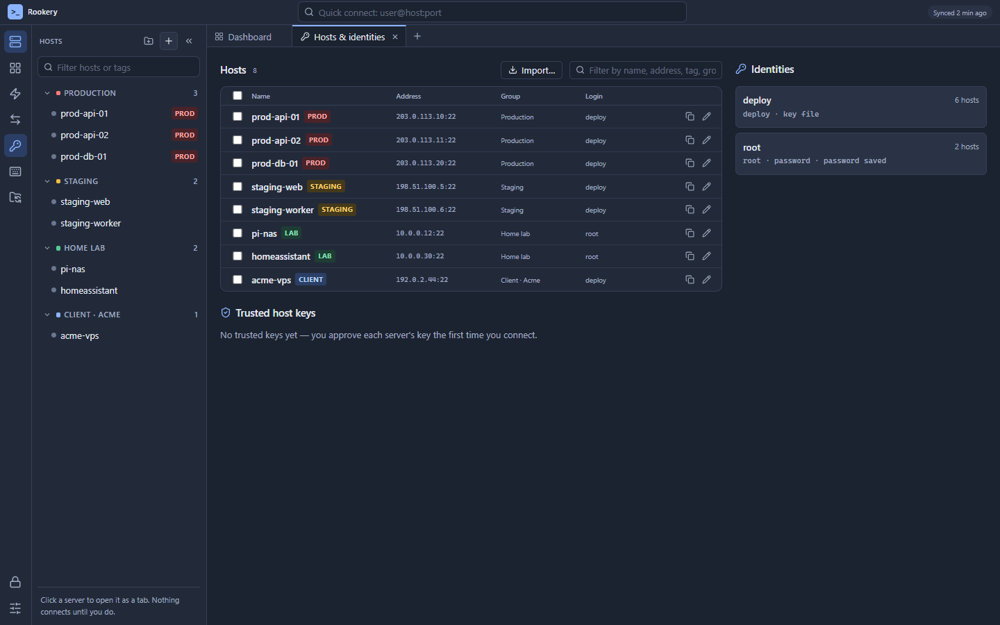 |
| Aliases, variables, workflows, scopes (all / tag / group / server / container), starter packs, import / export. | Every function bindable, several keys each, conflict warnings, presets, custom "type this text" keys. | Groups with inherited logins; bulk move / login / environment / tag; duplicate; trusted host keys. |

Also included:
- **Files (SFTP):** drag and drop, edit remotely in your own editor, with the panel following your terminal's `cd`.
- **Services:** systemd services.
- **Processes:** process list with kill.
- **Log files:** follow any log file on the server.
- **System-wide hotkey:** bring Rookery forward from any app.
- **Auto-lock:** the app locks itself after the time you choose.

## Download

**[⬇ Latest release](https://github.com/aagzamov-dev/Rookery/releases/latest)**

| | Download | First start |
|---|---|---|
| **Windows 10 / 11** | [Rookery_0.8.0_x64-setup.exe](https://github.com/aagzamov-dev/Rookery/releases/download/v0.8.0/Rookery_0.8.0_x64-setup.exe) | Installs for your user only (no admin). SmartScreen may warn once because the app isn't code-signed yet: **More info → Run anyway**. |
| **macOS** (Apple Silicon & Intel) | [Rookery_0.8.0_universal.dmg](https://github.com/aagzamov-dev/Rookery/releases/download/v0.8.0/Rookery_0.8.0_universal.dmg) | Drag to Applications, then run the command below once (the app isn't signed by Apple yet, so macOS says it's "damaged"). |

**macOS, first start:** run this once in Terminal, then open Rookery. Updates afterwards install normally.

```bash
xattr -dr com.apple.quarantine "/Applications/Rookery.app"
```

After that, Rookery updates itself (Settings › About). Updates are verified with Rookery's signature before they install.

## How it works

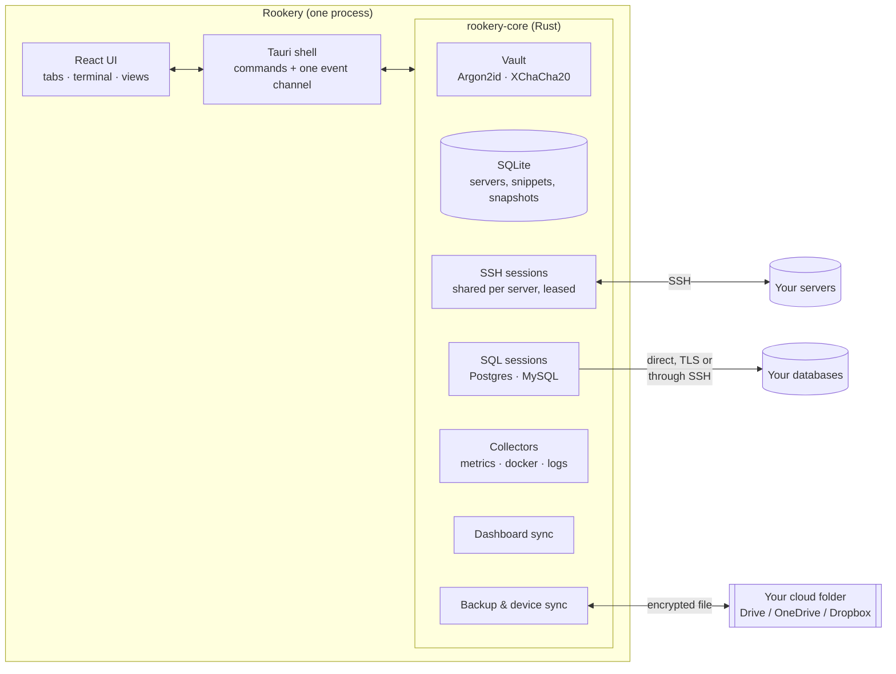

- **One SSH connection per server**, shared by all its terminals, file transfers and collectors. It closes 30 s after the last user lets go, and reconnects automatically if the network drops.
- **Collectors run only while you're looking:** the stats bar while the tab is active and the window focused, Docker stats while the Docker view is open, logs while the log panel is visible. Leaving a view stops them on the server too (the remote process is closed).
- **Databases** connect only when you open a database tab or view. "Through a server" goes over that server's SSH session (a forward that only listens on your own PC), and idle database connections close after 10 minutes.
- **Secrets stay in Rust:** the UI never receives a password or key. The vault key is only in memory, wiped on lock, and the PIN is wrapped by the OS keychain.
- **Network traffic Rookery starts on its own:** none to your servers. The only automatic request is a once-a-day update check of a small file on GitHub, and you can turn it off.

Data lives in `%APPDATA%\Rookery` (Windows) or `~/Library/Application Support/Rookery` (macOS): `rookery.db` (no secrets), `vault.bin` (encrypted), and `logs/` if session logging is on.

## Build from source

Requirements: [Rust](https://rustup.rs) (stable), Node.js 20+, plus WebView2 on Windows (already on Windows 11) or Xcode command line tools on macOS.

```bash
npm install
npm run dev          # the app with hot reload
npm test             # Rust + frontend tests
npm run build        # installer in target/release/bundle
```

- **Screenshots:** the images above are the real UI with made-up data. Run `npm --workspace apps/desktop run dev` and open `http://localhost:1420/demo.html?scene=dashboard` (scenes: `terminal`, `docker`, `sql`, `sql-table`, `sql-structure`, `sql-server`, `backup`, `hosts`, `shortcuts`, `snippets`).
- **Releasing:** raise the version (Cargo.toml, tauri.conf.json, both package.json), add its `docs/CHANGELOG.md` section, commit, then push a tag `vX.Y.Z`. GitHub Actions then builds Windows and macOS and publishes a signed release. Pushing `main` alone never releases. See [06-AUTO-UPDATE.md](docs/06-AUTO-UPDATE.md) §4.

```
crates/rookery-core    Rust core: vault, SQLite, SSH, SFTP, collectors, SQL connections, sync, backup, importers (no UI deps)
crates/rookery-tauri   Desktop shell: Tauri commands, events, plugins
apps/desktop           React + TypeScript UI (Vite, Tailwind, zustand, xterm.js)
```

## Project docs

[Start here](docs/00-START-HERE.md) · [Architecture](docs/01-ARCHITECTURE.md) · [Roadmap](docs/02-ROADMAP.md) · [Desktop features](docs/03-DESKTOP-FEATURES.md) · [Data, sync & security](docs/04-DATA-SYNC-SECURITY.md) · [Mobile & tablet](docs/05-MOBILE-TABLET.md) · [Auto-update](docs/06-AUTO-UPDATE.md) · [SQL connections](docs/07-SQL-CONNECTIONS.md) · [Changelog](docs/CHANGELOG.md)

## Roadmap

- **Next:** tunnels (port forwarding with on/off switches), jump hosts, SSH agent login, SSH key generator.
- **v1.0:** Android (then iOS), with the same core and a phone layout for checking servers and quick actions.

## License

[MIT](LICENSE)
